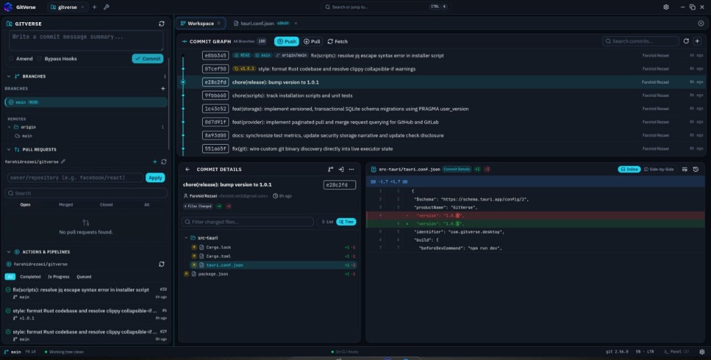
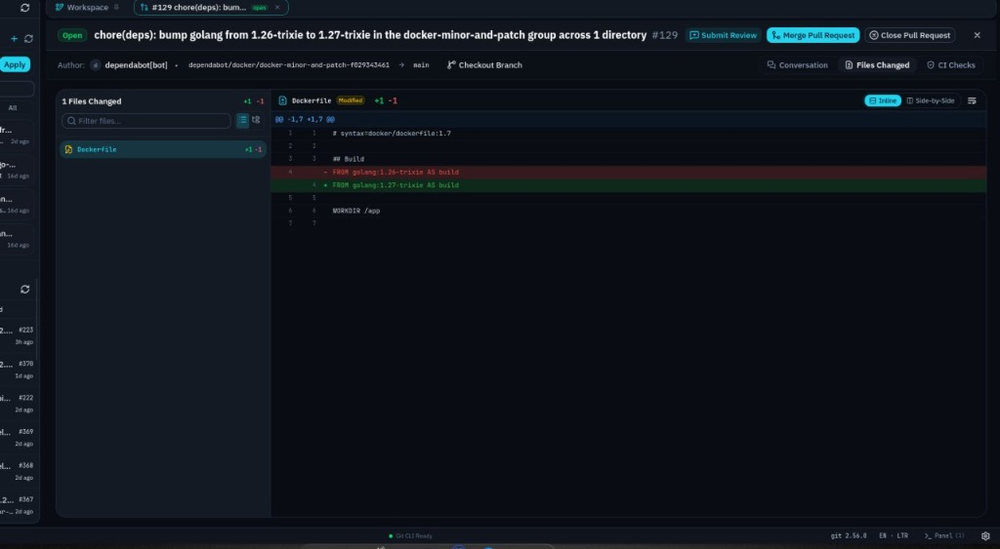
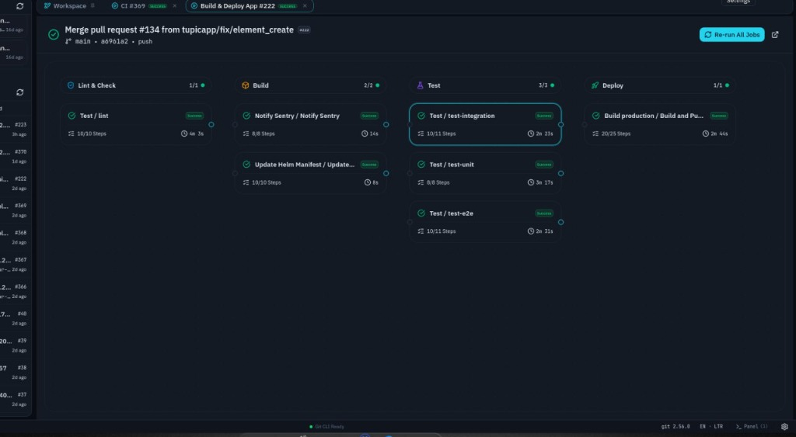

# GitVerse

<div align="center">


### Fast, Visual, and Local-First Git Desktop Client

**The Git client built for developers who want visual clarity without sacrificing the speed and fidelity of the native CLI.**

[](https://github.com/farshidrezaei/gitverse)
[](LICENSE)
[](#downloads--installation)
[](docs/I18N.md)

[Download](#downloads--installation) • [Features](#key-features) • [Why GitVerse?](#why-gitverse) • [Documentation](docs/ARCHITECTURE.md) • [Development](#quick-start-for-contributors)

<br />
<br />



</div>

---

## What is GitVerse?

**GitVerse** is an open-source, local-first Git desktop application that bridges the gap between raw command-line speed and high-level visual Git management.

Traditional Git GUIs are often slow, memory-hungry Electron wrappers that hide Git internals behind confusing proprietary layers. GitVerse is different: built on **Rust** and modern web standards, it acts as a lightweight visual layer directly atop your **system's native Git CLI**. It gives you clear interactive commit graphs, surgical line-by-line staging, and integrated GitHub/GitLab PR reviews—while consuming a fraction of the system resources.

---

## Why GitVerse?

| The Problem | How GitVerse Solves It |
|---|---|
| **Resource-heavy GUI clients** eat 1–2 GB of RAM just to view changes. | **Ultralight Rust core**: Launches in milliseconds, stays under 100 MB RAM, and renders with hardware acceleration. |
| **CLI lacks visual context** for complex branch trees and octopus merges. | **Intelligent Commit Graph**: Custom SVG DAG visualizer renders branch topologies, lane paths, and rebases with zero layout lag. |
| **Messy commits** caused by coarse `git add` and blunt file staging. | **Surgical Line & Hunk Staging**: Split or unified diff view with character-level intra-line highlights; stage or discard single lines with one click. |
| **Context switching** to browser tabs to review pull requests and CI status. | **Embedded PR Studio**: Review code, leave multi-line comment threads, approve, and merge GitHub/GitLab PRs without leaving the desktop. |
| **Accidental data loss** from mistyped CLI commands or irreversible UI clicks. | **Safety Net with Actionable Undo**: Tiered confirmations (hold-to-confirm for hard resets) and instant one-click undo toasts. |
| **RTL language neglect** makes interfaces awkward for Persian/Arabic developers. | **First-Class Bilingual Design**: Full native RTL/LTR mirroring with tailored Vazirmatn typography and zero text overlap. |

---

## Key Features

### 🗺️ Visual Commit Graph & History Exploration
- **Deterministic DAG Layout**: Custom mathematical graph engine with intelligent lane allocation and smooth Bézier curve connectors.
- **Fast Search & Filter**: Filter history by branch, author, date, commit message, or changed file paths instantly.
- **Detailed Commit Inspect**: Inspect author, commit metadata, parent SHAs, and file changes in a side-by-side or unified view.

### 🔬 Surgical Diff Viewer & Staging
- **Split & Unified Modes**: Choose between side-by-side comparison or unified single-column view.
- **Intra-Line Character Highlights**: Identify exact modified words and characters, not just lines.
- **Granular Control**: Stage, unstage, or discard whole files, individual hunks, or custom-selected lines.
- **Image Diff Support**: Visual comparison for common image formats.

### 🤝 Integrated Pull Request & Code Review Studio

<p align="center">
  
</p>

- **GitHub & GitLab Support**: Connect multiple accounts securely using native OS Keychains (no tokens stored in plain text).
- **In-App Reviews**: Review diffs, read discussion threads, write multi-line inline comments, and submit reviews (`APPROVE`, `REQUEST_CHANGES`, `COMMENT`).
- **CI/CD Checks**: Inspect build status, test pipelines, and workflow runs directly within each pull request tab.
- **Safe Remote Merge**: Merge branches using merge commit, squash, or rebase strategies.

### ⚡ Visual CI/CD Workflow & Pipeline Monitor

<p align="center">
  
</p>

- **Multi-Stage Pipeline Graphs**: Inspect multi-stage build, test, lint, and deploy workflows with live step execution counters and durations.
- **Instant Re-run & Inspection**: View failed job logs and trigger job re-runs directly from your desktop.

### 🗂️ Multi-Repository Tabs & Workspace Scopes
- **Two-Tier Tab Strip**: Keep multiple repositories open in tabs and switch between projects instantly.
- **Scoped Sub-Tabs**: Dedicated full-width tabs for detailed diff views and pull request reviews without losing your working context.
- **Zero-CLS Layout**: Dimensionally accurate skeleton loaders prevent annoying Cumulative Layout Shift during data loads.

### 🛡️ Local-First & Zero-Surprises Git Fidelity
- **Native Git as Single Source of Truth**: Executes commands directly via sanitized argument vectors—no black-box abstractions.
- **100% Config & Hook Parity**: Automatically respects your existing `.gitconfig`, aliases, global ignores, SSH keys, GPG signing, and Git hooks.
- **Fully Offline**: All local operations, history browsing, and diff inspections work seamlessly without internet connectivity.

### 🌍 Bilingual & Ergonomic Design
- **True RTL & LTR Symmetry**: Full Persian (`fa`) and English (`en`) dictionary parity with zero missing keys.
- **Theme Personalization**: High-contrast `GitVerse Dark` and `GitVerse Light` defaults, plus full customizable color token system.

---

## Comparison: GitVerse vs Others

| Feature | GitVerse | Electron Git GUIs | Basic Git GUI | Native CLI Only |
|:---|:---:|:---:|:---:|:---:|
| **Startup Speed** | ⚡ **< 300 ms** | 🐢 3–8 s | ⚡ Fast | ⚡ Instant |
| **Memory Footprint** | 🟢 **< 100 MB** | 🔴 800 MB – 2 GB | 🟢 < 150 MB | 🟢 < 30 MB |
| **System Git CLI Parity** | 🟢 **100% Native** | 🟡 Bundled / Divergent | 🟡 Partial | 🟢 100% |
| **Interactive Hunk / Line Staging** | 🟢 **Yes** | 🟢 Yes | 🟡 Partial | 🟡 Complex (`git add -p`) |
| **Custom SVG Commit Graph** | 🟢 **Yes (Virtual DAG)** | 🟢 Yes | 🔴 Basic / Plain | 🔴 ASCII text |
| **GitHub & GitLab PR Reviews** | 🟢 **Built-in** | 🟡 Paid / Plugin | 🔴 None | 🔴 Browser needed |
| **Safety Net & One-Click Undo** | 🟢 **Tiered + Undo Toast** | 🟡 Basic prompt | 🔴 None | 🔴 None |
| **Native RTL / Persian Support** | 🟢 **First-Class** | 🔴 None / Broken | 🔴 None | 🔴 Terminal broken |
| **License & Extensibility** | 🟢 **Open-Source (MIT)** | 🔴 Proprietary / Paid tiers | 🟢 Mixed | 🟢 Open Source |

---

## Downloads & Installation

### 🚀 One-Line Quick Install (Recommended)

Install or update GitVerse automatically with a single command. The installer detects your OS and architecture, checks for existing installations, prompts for upgrades/reinstalls, and sets up your system desktop launcher:

**Linux & macOS:**
```bash
curl -fsSL https://raw.githubusercontent.com/farshidrezaei/gitverse/main/scripts/install.sh | bash
```

**Windows (PowerShell):**
```powershell
irm https://raw.githubusercontent.com/farshidrezaei/gitverse/main/scripts/install.ps1 | iex
```

> [!TIP]
> **Smart Re-run & In-Place Updates**: Running the installer again automatically checks GitHub for newer releases. If a newer version is available, it offers a 1-click update. If already up to date, it prompts if you wish to reinstall.
>
> Pass `--force` (`-Force` on Windows) for silent/CI execution, or `--help` to see options like `--version <tag>` and `--uninstall`.

---

### 📦 Manual Binary Downloads

Standalone installers and portable packages are available for all major platforms on the [Releases page](https://github.com/farshidrezaei/gitverse/releases/latest):

| Platform | Architecture | Package Format | Direct Download |
|---|---|---|---|
| **macOS** | Universal (`Apple Silicon` + `Intel`) | `.dmg` | [Download macOS DMG](https://github.com/farshidrezaei/gitverse/releases/latest) |
| **Linux** | `x86_64` | `.AppImage` (Portable) | [Download Linux AppImage](https://github.com/farshidrezaei/gitverse/releases/latest) |
| **Linux** | `x86_64` | `.deb` (Debian, Ubuntu) | [Download Linux DEB](https://github.com/farshidrezaei/gitverse/releases/latest) |
| **Linux** | `x86_64` | `.rpm` (Fedora, RHEL) | [Download Linux RPM](https://github.com/farshidrezaei/gitverse/releases/latest) |
| **Windows** | `x64` | `.exe` (NSIS Installer) | [Download Windows Installer](https://github.com/farshidrezaei/gitverse/releases/latest) |
| **Windows** | `x64` | `.msi` (Enterprise Package) | [Download Windows MSI](https://github.com/farshidrezaei/gitverse/releases/latest) |

Every release includes verifiable SHA256 checksums in `SHA256SUMS.txt`.

---

## Quick Start for Contributors

### Prerequisites
- **Node.js**: `20.x` or `22.x` / `24.x` (LTS recommended)
- **Rust Toolchain**: Stable `1.80+` (`rustup update stable`)
- **Native Git**: `2.30+` installed on host system
- **System Libraries (Linux)**: `webkit2gtk-4.1`, `libappindicator3-dev`, `librsvg2-dev`

### Development Setup

```bash
# 1. Clone the repository
git clone https://github.com/farshidrezaei/gitverse.git
cd gitverse

# 2. Install dependencies
npm install

# 3. Validate translations
npm run validate:i18n

# 4. Start frontend preview in browser
npm run dev

# 5. Launch Tauri desktop app in dev mode
npm run tauri dev
```

### Running Tests

```bash
# Frontend unit and component tests (Vitest)
npm run test:unit

# Rust tests (unit, integration, property DAG tests)
cargo test --manifest-path src-tauri/Cargo.toml

# Translation parity verification (English & Persian)
npm run validate:i18n

# TypeScript strict type checking
npm run typecheck
```

---

## Architecture & Design Principles

GitVerse is engineered under strict engineering quality contracts:

- **Modular Monolith**: Clean layer separation between Tauri/Rust background supervisors, domain business logic, and modern Nuxt 4 frontend components.
- **Zero-CLS Skeletons**: Dimension-accurate `USkeleton` elements ensure zero visual jumps during asynchronous operations.
- **Dual-Layer Validation**: Strict frontend Zod validation paired with Rust domain validators for complete data integrity.
- **Zero Abbreviations & No Hardcoded Strings**: 100% of UI strings are localized across both `en` and `fa`.

For deep dives into the technical details, read our documentation:
- 🏗️ **[System Architecture](docs/ARCHITECTURE.md)** — IPC, security model, and component layout
- ⚖️ **[Architectural Decision Records (ADRs)](docs/DECISIONS.md)** — Design decisions and rationale
- 🎨 **[Design System](docs/DESIGN-SYSTEM.md)** — Tokens, CSS variables, and accessibility
- 🧪 **[Testing Strategy](docs/TESTING.md)** — Table-driven, property, and matrix tests
- 📜 **[Engineering Constitution](AGENTS.md)** — Mandatory standards for all contributors

---

## Contributing

We welcome contributions! Please review our **[Contributing Guide](CONTRIBUTING.md)** and make sure all PRs adhere to the **[Engineering Constitution](AGENTS.md)**.

---

## License

GitVerse is open-source software licensed under the **[MIT License](LICENSE)**.
