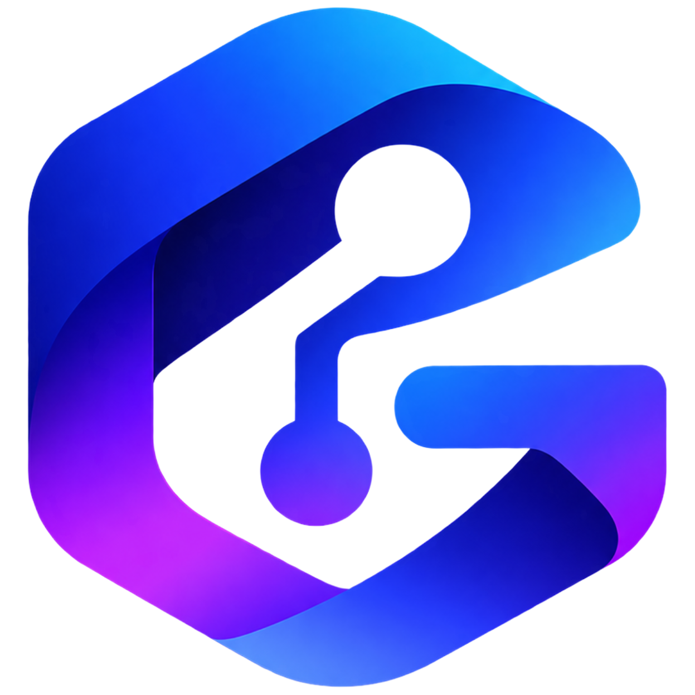
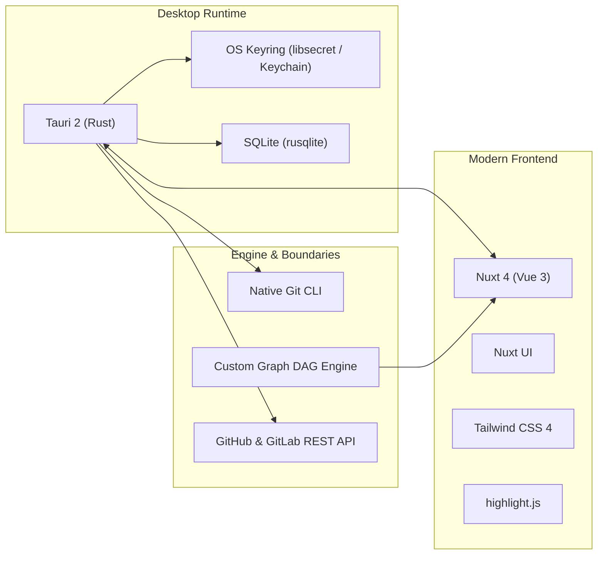

# GitVerse

<div align="center">



### Modern, Cross-Platform, Local-First Git Desktop Client

[](https://github.com/farshidrezaei/gitverse)
[](LICENSE)
[](https://tauri.app)
[](https://nuxt.com)
[](https://tailwindcss.com)

**GitVerse** combines the raw power of the native Git CLI with an in-house commit graph engine, interactive diff/patch manipulation, zero-layout-shift design, and seamless GitHub/GitLab integration into an ultra-fast desktop experience.

[English](README.md) • [فارسی](docs/I18N.md) • [Architecture](docs/ARCHITECTURE.md) • [Design System](docs/DESIGN-SYSTEM.md) • [Testing](docs/TESTING.md) • [Changelog](CHANGELOG.md)

</div>

---

## Key Highlights

- **Native Git CLI Core ([ADR-001](docs/DECISIONS.md#adr-001))**: Safe process execution via argument arrays without shell interpolation. Respects your existing `.gitconfig`, SSH keys, and custom credentials.
- **In-House Commit Graph Engine ([ADR-002](docs/DECISIONS.md#adr-002))**: Custom DAG builder with deterministic lane allocation, Bézier curve paths, and high-performance virtualized SVG rendering.
- **Local-First & Offline Resilience ([ADR-003](docs/DECISIONS.md#adr-003))**: Functions 100% offline. Local SQLite metadata persistence, OS Keychain security for tokens.
- **GitHub & GitLab Remote Integration ([ADR-004](docs/DECISIONS.md#adr-004))**: Browse pull requests, review multi-line code changes, submit reviews (`APPROVE`, `REQUEST_CHANGES`), merge remotes (`merge`, `squash`, `rebase`), and inspect CI/CD checks without leaving the app.
- **Granular Interactive Diff Viewer**: Stage, unstage, or discard hunks and custom selected lines. Side-by-side (split) and unified diff modes with character-level intra-line highlights and image diff tools.
- **Hierarchical Two-Level Tab Strip**: Manage multiple active repositories alongside dedicated, scoped diff and pull request tabs with instant switching (`0ms` CLS).
- **Zero-CLS High-Fidelity Skeletons**: Dimensionally accurate skeleton loaders across all panels, sidebars, and modals to prevent visual jumping.
- **Developer Design System & Full Bilingual Parity**: Built-in `GitVerse Dark` and `GitVerse Light` with full CSS variable customization, supporting English (LTR) and Persian (RTL with Vazirmatn).

---

## Technical Stack



| Area | Technologies |
|---|---|
| **Desktop Runtime** | Tauri 2, Rust 1.80+ |
| **Frontend Framework** | Nuxt 4, Vue 3.5, TypeScript 5.8 (Strict) |
| **Component System** | Nuxt UI, Tailwind CSS 4, Reka UI |
| **Syntax & Markdown** | Highlight.js, Marked |
| **Storage & Security** | SQLite, OS Keyring (`keyring-rs`) |
| **Process Execution** | Asynchronous Git CLI process supervisor (Tokio) |
| **Test Suites** | Vitest (Frontend unit tests), Cargo Test (Rust unit & proptests) |

---

## Installation & Downloads

Pre-built application binaries for all supported platforms are automatically generated on every tagged release:

| Platform | Architecture | Package Format | Direct Download |
|---|---|---|---|
| **macOS** | Universal (`Apple Silicon` + `Intel`) | `.dmg` | [Latest macOS DMG](https://github.com/farshidrezaei/gitverse/releases/latest) |
| **Linux** | `x86_64` | `.AppImage` (Standalone portable) | [Latest Linux AppImage](https://github.com/farshidrezaei/gitverse/releases/latest) |
| **Linux** | `x86_64` | `.deb` (Debian / Ubuntu) | [Latest Linux DEB](https://github.com/farshidrezaei/gitverse/releases/latest) |
| **Linux** | `x86_64` | `.rpm` (Fedora / RHEL / openSUSE) | [Latest Linux RPM](https://github.com/farshidrezaei/gitverse/releases/latest) |
| **Windows** | `x64` | `.exe` (NSIS Installer) | [Latest Windows Installer](https://github.com/farshidrezaei/gitverse/releases/latest) |
| **Windows** | `x64` | `.msi` (Enterprise MSI Package) | [Latest Windows MSI](https://github.com/farshidrezaei/gitverse/releases/latest) |

SHA256 checksums are published in `SHA256SUMS.txt` alongside every release for binary integrity verification.

---

## Getting Started

### Prerequisites

- **Node.js**: `20.x` or `22.x` / `24.x` (LTS recommended)
- **Rust Toolchain**: Stable `1.80+` (`rustup update stable`)
- **Native Git**: `2.30+` installed on host system
- **System Libraries (Linux)**: `webkit2gtk-4.1`, `libappindicator3-dev`, `librsvg2-dev`

### Installation & Development

```bash
# 1. Clone repository
git clone https://github.com/farshidrezaei/gitverse.git
cd gitverse

# 2. Install dependencies
npm install

# 3. Validate translations
node scripts/validate-i18n.mjs

# 4. Start frontend preview in browser
npm run dev

# 5. Launch Tauri desktop app in dev mode
npm run tauri dev
```

### Running Test Suites

```bash
# Run all frontend tests (107 Vitest unit & E2E tests)
npm run test:unit

# Run Rust tests (47 unit, integration, benchmark, and property tests)
cargo test --manifest-path src-tauri/Cargo.toml

# Validate internationalization dictionary parity (en & fa)
npm run validate:i18n

# Typecheck TypeScript codebase
npm run typecheck

# Production verification build
npm run build
```

---

## Architectural & Technical Documentation

For deep architectural reviews and module guides, refer to the documentation suite in `/docs`:

- **[System Architecture](docs/ARCHITECTURE.md)**: Overall application layers, IPC protocol, and security model.
- **[Architectural Decision Records (ADRs)](docs/DECISIONS.md)**: Fundamental trade-offs and decisions (CLI vs libgit2, custom DAG, etc.).
- **[Design System & Tokens](docs/DESIGN-SYSTEM.md)**: Color ramps, CSS tokens, WCAG contrast rules, and living style guide.
- **[Commit Graph Engine](docs/modules/COMMIT-GRAPH.md)**: Mathematical DAG layout, lane allocation algorithms, and SVG virtualization.
- **[Diff Engine & Patching](docs/modules/DIFF-ENGINE.md)**: Unified/split views, intra-line word diffs, hunk/line patch generation.
- **[Git Process Runner](docs/modules/GIT-EXECUTION.md)**: Argument vector isolation, sanitization rules, and typed error handling.
- **[Cloud Provider Integration](docs/modules/PROVIDER-INTEGRATION.md)**: GitHub/GitLab pull requests, multi-line review comments, merge strategies, and CI/CD pipelines.
- **[Workspace Tabs](docs/modules/WORKSPACE-TABS.md)**: Multi-repository tabs and scoped full-screen pull request tabs.
- **[Testing Strategy](docs/TESTING.md)**: Table-driven tests, proptest property testing, and integration matrices.
- **[Internationalization (i18n)](docs/I18N.md)**: English and Persian parity, RTL mirroring, and automated CI key validation.
- **[Development Guide](docs/DEVELOPMENT.md)**: Setup, workflow, branching, and release practices.
- **[Portable Distribution & Installation](docs/PORTABLE-DISTRIBUTION.md)**: Standalone AppImage, DMG, and portable Windows executable guides.
- **[Contributing Guide](CONTRIBUTING.md)**: Contribution standards, code style, and PR checklist.
- **[Security Policy](SECURITY.md)**: Security architecture, credential handling, and vulnerability disclosure.
- **[Changelog](CHANGELOG.md)**: Full version history and release notes.

---

## Engineering Constitution

All contributors and coding agents must strictly adhere to the non-negotiable rules outlined in **[`AGENTS.md`](./AGENTS.md)**:
1. **Zero Abbreviations**: Prohibited identifiers like `repo`, `req`, `res`, `msg`, `auth`, `env`.
2. **No Hardcoded Magic Values**: Design tokens, enums, or translation keys must be used.
3. **Zero-CLS Standard**: Strictly `USkeleton` loaders (no generic spinners or "Loading..." text).
4. **Opaque Modal Surfaces**: No transparent dialogs; opaque surfaces with elevation borders are mandatory.
5. **Strict TypeScript & Rust Safety**: `strict: true` and zero unchecked `.unwrap()`.

---

## License

This project is licensed under the [MIT License](LICENSE).
