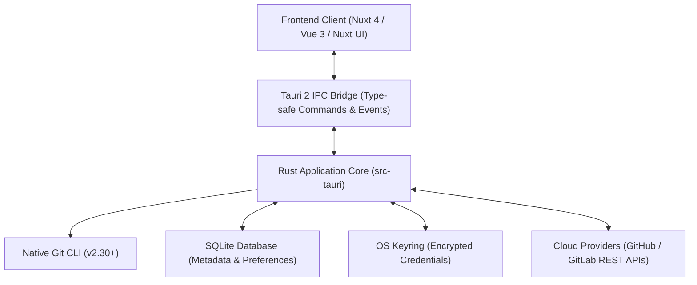
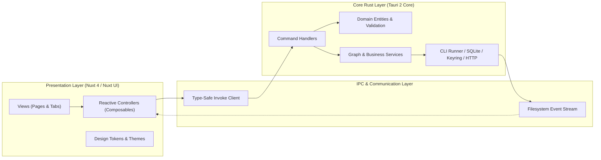
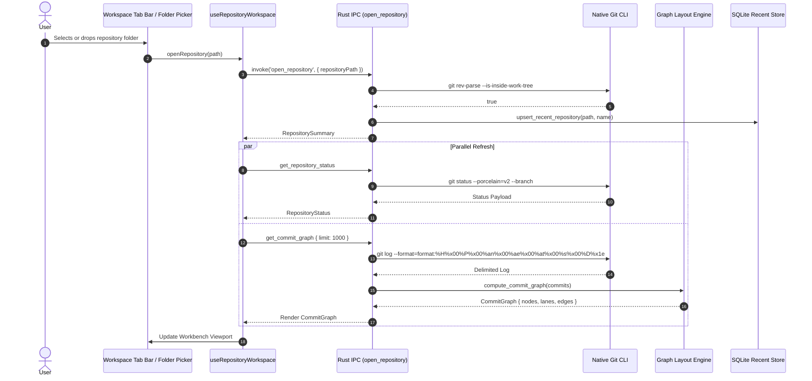
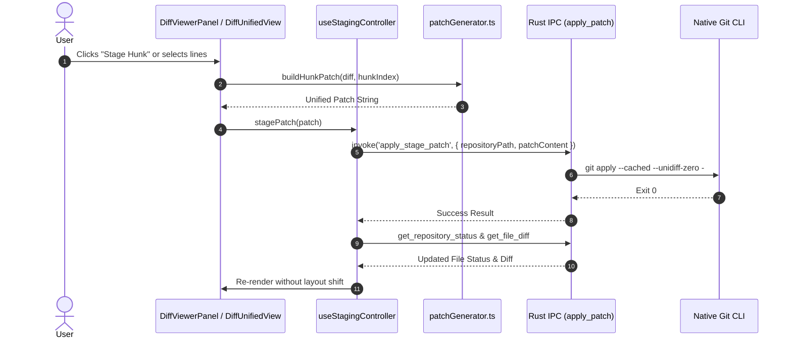

# System Architecture & Technical Specification

> Comprehensive architectural specification, module interactions, data flows, and design invariants for GitVerse.

---

## 1. Executive Summary

**GitVerse** is an open-source, local-first, cross-platform Git desktop client engineered with **Tauri 2**, **Rust**, **Nuxt 4**, **Tailwind CSS 4**, **Nuxt UI**, and **SQLite**. 

The fundamental architectural mission is to unify high-performance local Git operations, deterministic commit graph visualization, interactive diff manipulation, and cloud provider workflows (GitHub & GitLab) into an intuitive, keyboard-first, zero-layout-shift application.



---

## 2. Architectural Pillars & Core Principles

### 2.1. Local-First & Single Source of Truth (ADR-001 & ADR-003)
- The local filesystem and native Git CLI remain the absolute single source of truth for repository state, commit history, branch references, and working tree changes.
- The desktop app functions 100% offline. Network connectivity is strictly confined to remote operations (`git push`, `git pull`, `git fetch`) and cloud provider synchronization (PRs, issues, CI checks).
- In-memory state acts as an ephemeral reactive cache that invalidates immediately upon repository changes via debounced filesystem watchers or explicit command completions.

### 2.2. Native Git CLI Execution Over libgit2 (ADR-001)
- GitVerse executes the user's native `git` CLI executable using isolated argument arrays (`std::process::Command` / `tokio::process::Command`).
- **Zero shell interpolation**: Commands are never constructed via string formatting, preventing shell injection vulnerabilities.
- Guaranteed compatibility with user global Git configuration (`.gitconfig`), SSH agent, GPG signing keys, custom credentials helpers, and custom Git hooks.

### 2.3. Custom In-House Commit Graph Engine (ADR-002)
- DAG construction and topological sorting occur within Rust (`services/graph.rs`).
- Lane assignment is deterministic: branch heads retain persistent lanes without lane jitter or arbitrary crossing lines.
- The frontend renders lanes, curves, merge splits, and commit nodes via SVG paths (`CommitGraphSvgCanvas.vue`) positioned with virtualized coordinates.

### 2.4. Modular Monolith Architecture
- Clean separation of concerns between backend domains and frontend feature islands.
- No "God files" or oversized components. Components are scoped strictly by domain:
  - Rust: `application/`, `commands/`, `domain/`, `infrastructure/`, `services/`.
  - Frontend: `components/workspace/{branch, commit, diff, provider, staging, tabs}`, `composables/`, `utils/`, `schemas/`.

---

## 3. High-Level System Layers



### Layer Responsibilities

| Layer | Responsibility | Key Modules |
|---|---|---|
| **Presentation (Frontend)** | User interface, virtualized scrolling, reactive layouts, RTL/LTR layout symmetry, design system token binding. | `app/components/`, `app/pages/`, `app/layouts/` |
| **State Controllers (Composables)** | Reactive business workflows, caching, modal orchestration, optimistic updates. | `useWorkspaceManager`, `useProviderController`, `useCommitGraph` |
| **Type Validation & Schemas** | Runtime parameter validation using Zod for frontend and serde/domain validators for Rust. | `app/schemas/`, `src-tauri/src/domain/validation.rs` |
| **Rust Tauri Commands** | Structured command dispatch, argument validation, and error propagation via `thiserror`. | `src-tauri/src/commands/repository.rs`, `commands/provider.rs` |
| **Domain Services** | Computational algorithms (DAG generation, deterministic lane assignment, diff parsing). | `src-tauri/src/services/graph.rs`, `infrastructure/git/diff.rs` |
| **Infrastructure Adapters** | External boundaries: Git CLI process executor, SQLite database manager, OS Keyring, Reqwest HTTP client, privacy-safe logger & diagnostics. | `infrastructure/git/`, `infrastructure/storage/`, `infrastructure/security/`, `infrastructure/provider/`, `infrastructure/diagnostics.rs` |

---

## 4. End-to-End Execution Lifecycles

### 4.1. Repository Opening & Graph Ingestion Lifecycle



### 4.2. File Staging & Hunk Patching Lifecycle



---

## 5. Security & Isolation Architecture

1. **Strict Process Sanitization**:
   - Every Git invocation executes through `std::process::Command::new("git")` with sanitized directory path strings.
   - Command arguments are strictly passed as vector items (`.args(&["checkout", branch_name])`), preventing argument injection.
2. **Credential Privacy**:
   - Access tokens (GitHub PAT, GitLab PAT) are persisted directly to the host OS Secure Enclave / Keyring via the `keyring` crate.
   - If keyring is unavailable in headless environments, fallback credentials use file encryption with restricted permissions (`0600`).
   - Tokens, credentials, and sensitive headers are excluded from logs, error serializations, and command payloads.
3. **Markdown Sanitization & Safe DOM Rendering**:
   - Markdown rendering in pull requests and commit inspectors parses through `marked` with custom syntax highlighting via `highlight.js`.
   - All HTML is processed through `sanitizeHtmlSimple` to neutralize script tags, iframe embeds, object tags, and javascript URI schemes before injection.
4. **Modal Architecture Guarantee**:
   - Every modal enforces an opaque background (`bg-[var(--gv-surface)]`), standard backdrop blur overlay, and elevation borders. Modal transparency is strictly banned.

---

## 6. Directory Structure & Codebase Map

```text
gitverse/
├── app/                              # Frontend Presentation & Application Layer
│   ├── app.config.ts                 # Nuxt UI global theme overrides & slot presets
│   ├── app.vue                       # Root application shell, title bar, hotkeys
│   ├── assets/css/main.css           # Tailwind v4, design tokens, custom properties
│   ├── components/                   # Vue 3 component features organized by domain
│   │   ├── design-system/            # Living style guide & theme inspector components
│   │   ├── layout/                   # Window chrome, title bar, status bar footer
│   │   ├── settings/                 # Settings modal cards (accounts, git engine, appearance)
│   │   ├── shared/                   # Atomic UI primitives (badges, pills, dialogs, logos)
│   │   └── workspace/                # Primary Git workbench islands
│   │       ├── branch/               # Branch tree sidebar & reference managers
│   │       ├── commit/               # Commit header, inspector, changed file list, conventional builder, multi-commit queue
│   │       ├── diff/                 # Unified & split diff viewers, media viewers, interactive file blame
│   │       ├── graph/                # Virtualized SVG canvas & commit rows
│   │       ├── history/              # Reflog explorer & lost commit recovery
│   │       ├── history/              # Reflog explorer, lost commit recovery, single-file timeline scrubber
│   │       ├── bisect/               # Interactive Git bisect assistant & regression debugger
│   │       ├── patch/                # Export & apply unified diff and format-patch files
│   │       ├── archive/              # Offline Git bundles & clean source archive (.zip/.tar) exporter
│   │       ├── lfs/                  # Git LFS object storage, pattern tracking & lock manager
│   │       ├── submodule/            # Nested Git submodules status, sync, and recursive updates
│   │       ├── insights/             # Repository analytics, code churn, and contributor velocity
│   │       ├── search/               # Global repository code & regex search (git grep)
│   │       ├── provider/             # Pull request explorer, code review, merge modals
│   │       ├── remote/               # Remote repository add/edit/manage modals
│   │       ├── staging/              # Working tree changes, stash preview & diff inspection, conflict resolver
│   │       └── tabs/                 # Top repository tab strip, scoped diff/PR tabs & external tool launchers
│   ├── composables/                  # Modular state controllers (30 domain controllers)
│   ├── pages/                        # Nuxt routes (/ for workbench, /design-system, /settings)
│   ├── schemas/                      # Zod validation schemas for inputs & forms
│   ├── types/                        # Strict TypeScript interfaces matching Rust models
│   └── utils/                        # Pure stateless utility algorithms (DAG, diffs, formatters)
├── docs/                             # Engineering specifications & ADRs
│   ├── ARCHITECTURE.md               # System overview (this document)
│   ├── DECISIONS.md                  # Architectural Decision Records (ADRs)
│   ├── DESIGN-SYSTEM.md              # Design tokens, color system, and UI guidelines
│   ├── DEVELOPMENT.md                # Local environment setup and developer guide
│   ├── I18N.md                       # Localization, translation parity, and RTL standards
│   ├── PORTABLE-DISTRIBUTION.md      # Portable packaging & installation specifications
│   ├── TESTING.md                    # Verification matrix, test suites, and proptests
│   └── modules/                      # Deep-dive module specifications
│       ├── COMMIT-GRAPH.md           # Custom DAG layout & virtualization engine
│       ├── DIFF-ENGINE.md            # Line-by-line diff, intra-line spans & hunk patching
│       ├── GIT-EXECUTION.md          # Git CLI process orchestration & error mapping
│       ├── PROVIDER-INTEGRATION.md   # GitHub & GitLab review, merge, and CI pipeline sync
│       └── WORKSPACE-TABS.md         # Multi-repository & scoped diff/PR tab controller
├── i18n/locales/                     # Complete en.json and fa.json localization dictionaries
├── scripts/                          # CI & automated validation utilities
├── src-tauri/                        # Native Rust Application Core
│   ├── Cargo.toml                    # Rust dependencies & Tauri 2 configuration
│   ├── src/
│   │   ├── application/              # Application lifecycle, state containers
│   │   ├── commands/                 # Tauri IPC command dispatchers
│   │   ├── domain/                   # Pure business entities, enums, and validators
│   │   ├── infrastructure/           # Process runner, SQLite, Keyring, Git adapters, diagnostics logger, bisect, patch, submodule, insights, file history, code search, git bundle & archive, lfs
│   │   ├── services/                 # Graph DAG computation algorithms & benchmarks
│   │   ├── lib.rs                    # Plugin registration, invoke handlers, initialization
│   │   └── main.rs                   # Desktop entrypoint
│   └── test/                         # Frontend Vitest test suites (138 passing unit & E2E tests; 79 Rust unit/integration tests)
```
