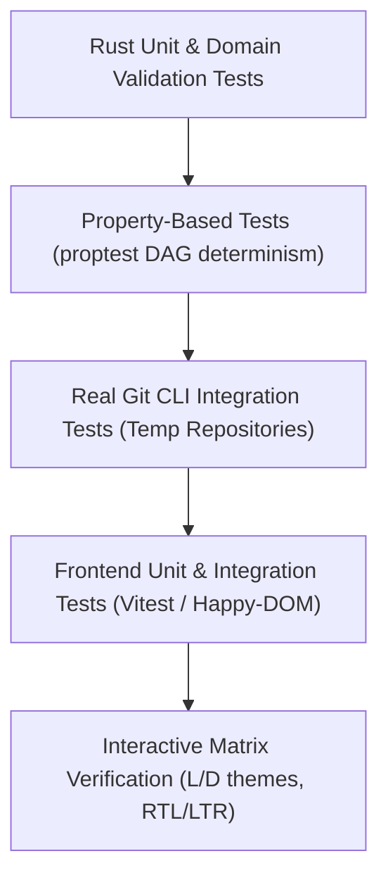

# GitVerse — Testing Constitution & Quality Assurance

> Testing philosophy, test pyramid, coverage requirements, property testing, and verification procedures for GitVerse.

---

## 1. Testing Constitution & Quality Gates

In accordance with **AGENTS.md Section 4**:
> **A feature is not complete when it compiles.** Every feature, bug fix, and refactoring requires comprehensive automated verification across multiple test tiers.

### Quality Gate Checkpoints:
1. `node scripts/validate-i18n.mjs` — Zero missing translation keys or mismatched interpolation placeholders.
2. `npm run test` (Vitest) — 100% of frontend unit tests passing.
3. `cargo test --manifest-path src-tauri/Cargo.toml` — 100% of Rust unit, integration, and proptests passing.
4. `npm run build` — Clean production build without warnings or compilation failures.

---

## 2. Test Hierarchy & Pyramid



### Coverage by Tier

| Tier | Tooling | Focus Areas | Current Tests |
|---|---|---|---|
| **Rust Unit Tests** | `cargo test` | Commit parsing, porcelain v2 status, unified diff hunks, validation rules, token sanitization, diagnostics. | 30 tests |
| **Rust Property Tests** | `proptest` | Commit graph DAG determinism, lane allocation stability with random topologies. | 2 tests |
| **Rust Benchmark Tests** | `cargo test` | 2,000 & 10,000 commit DAG layout generation stress tests (< 30ms total execution). | 2 tests |
| **Rust Integration Tests** | `tempfile`, native `git` | Scratch repositories with real commits, branches, merges, stashes, and remotes. | 12 tests |
| **Frontend Unit & E2E Tests** | `vitest`, `happy-dom` | Complete workflow simulation, composables, patch generator, Zod schemas, file tree algorithms, markdown renderer, crash prevention & error formatting. | 107 tests |
| **Translation Validation** | Node.js | Key count parity, placeholder matching across `en.json` and `fa.json`. | Automated script |

---

## 3. Real Git Scratch Repository Testing

Integration tests in `src-tauri/src/lib_test.rs` create isolated temporary repositories on disk using `tempfile`:

```rust
fn create_test_repository() -> (tempfile::TempDir, std::path::PathBuf) {
    let temp_dir = tempfile::tempdir().expect("Failed to create temporary directory");
    let repo_path = temp_dir.path().to_path_buf();

    // Initialize Git repo with safe user defaults
    run_git_cmd(&repo_path, &["init"]);
    run_git_cmd(&repo_path, &["config", "user.name", "Test User"]);
    run_git_cmd(&repo_path, &["config", "user.email", "test@gitverse.test"]);
    run_git_cmd(&repo_path, &["config", "commit.gpgsign", "false"]);

    (temp_dir, repo_path)
}
```

This guarantees that:
- Real Git commands run against real filesystem inodes.
- Edge cases (dirty index, detached HEAD, merge conflicts, CRLF vs LF line endings) are verified under realistic conditions.
- Temporary files are automatically cleaned up when `temp_dir` is dropped.

---

## 4. Property-Based Testing (`proptest`)

The commit graph engine uses property-based tests to ensure determinism:
- Random DAG structures are synthesized with varying branch counts and merge topologies.
- The property test verifies that passing the same commit history in topological order **always yields the exact same lane assignments and edge trajectories**.

---

## 5. Commit Graph Performance Benchmarks

In-memory benchmarks verify scalability across high-density repositories:
- **2,000 Commits**: Synthesizes a non-linear history with divergent branches and frequent merges every 5 commits. Verifies DAG layout time is strictly < 250ms (measured at ~4ms in CI/local).
- **10,000 Commits**: Large-scale repository history stress test with criss-cross merges. Verifies deterministic lane assignment finishes well under 1,200ms (measured at ~25ms).

Run benchmarks specifically:
```bash
cargo test --manifest-path src-tauri/Cargo.toml test_benchmark
```

---

## 6. Verification Commands

```bash
# 1. Run all frontend unit & E2E tests (107 tests)
npm run test:unit

# 2. Run all Rust unit, integration, and property tests (46 tests)
cargo test --manifest-path src-tauri/Cargo.toml

# 3. Run i18n parity check
npm run validate:i18n

# 4. Run type check
npm run typecheck

# 5. Run production Nuxt build
npm run build
```
