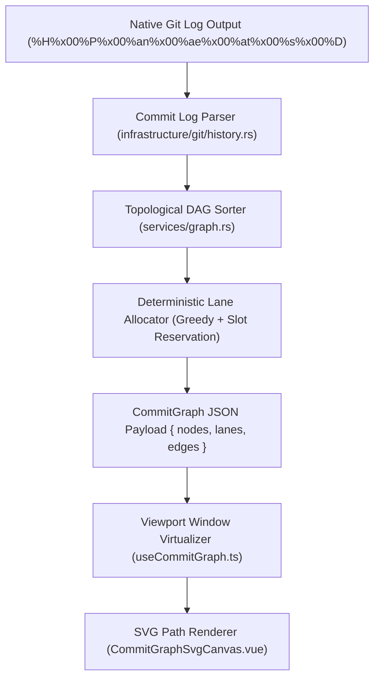
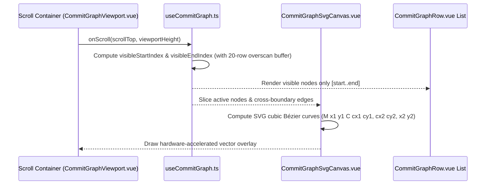

# Commit Graph Engine & Visualization Specification

> Mathematical specification, DAG layout algorithm, lane assignment heuristics, and virtualized SVG rendering rules for the in-house GitVerse Commit Graph.

---

## 1. Module Overview

The GitVerse Commit Graph engine operates under **ADR-002: In-House Custom Commit Graph Engine**. Rather than delegating DAG generation or lane assignment to an opaque WebAssembly library or raw CLI ASCII graph (`git log --graph`), GitVerse owns the entire pipeline from topological sort to SVG rendering.



---

## 2. Mathematical Model & Data Structures

A Git commit history is a Directed Acyclic Graph $G = (V, E)$ where:
- $V = \{c_1, c_2, \dots, c_n\}$ is the set of commit nodes ordered chronologically descending by commit timestamp and topological dependency.
- $E = \{(c_i, c_j) \mid c_j \in \text{parents}(c_i)\}$ represents directed edges pointing backward from child commits to their parent commits.

### Rust Domain Entities (`src-tauri/src/domain/graph.rs`)

```rust
#[derive(Debug, Clone, Serialize, Deserialize, PartialEq)]
pub struct CommitGraphNode {
    pub hash: String,
    pub parents: Vec<String>,
    pub author_name: String,
    pub author_email: String,
    pub timestamp: i64,
    pub summary: String,
    pub decorations: Vec<CommitDecoration>,
    pub lane_index: usize,
    pub is_merge_commit: bool,
}

#[derive(Debug, Clone, Serialize, Deserialize, PartialEq)]
pub struct CommitGraphEdge {
    pub from_hash: String,
    pub to_hash: String,
    pub from_lane: usize,
    pub to_lane: usize,
    pub is_direct: bool, // True if connecting consecutive rows
}

#[derive(Debug, Clone, Serialize, Deserialize, PartialEq)]
pub struct CommitGraph {
    pub nodes: Vec<CommitGraphNode>,
    pub edges: Vec<CommitGraphEdge>,
    pub total_lanes_count: usize,
}
```

---

## 3. Lane Allocation Algorithm

The goal of the lane allocator is to assign every node $c_i$ a lane index $L(c_i) \in [0, M-1]$ such that:
1. **Determinism**: Identical commit history graphs always yield identical lane topologies.
2. **Lane Stability**: Branch lines stay straight as long as possible without unnecessary horizontal hops.
3. **Primary Line Continuity**: The active branch (`HEAD`) always occupies lane 0 whenever reachable.
4. **Collision Avoidance**: Active vertical branches do not overlap or intersect ambiguously.

### Lane Allocation Rules (Pseudocode)

```rust
// Active lanes vector tracks the commit hash currently occupying each lane slot
let mut active_lanes: Vec<Option<String>> = Vec::new();

for node in commits_in_topological_order {
    // 1. Locate if this node was expected by an earlier child in an existing lane
    let existing_lane = active_lanes.iter().position(|slot| slot.as_ref() == Some(&node.hash));

    let assigned_lane = match existing_lane {
        Some(lane_idx) => {
            // Re-use already reserved lane
            active_lanes[lane_idx] = None;
            lane_idx
        }
        None => {
            // Find lowest available free lane slot or create a new lane
            let free_slot = active_lanes.iter().position(|slot| slot.is_none());
            match free_slot {
                Some(slot) => slot,
                None => {
                    active_lanes.push(None);
                    active_lanes.len() - 1
                }
            }
        }
    };

    node.lane_index = assigned_lane;

    // 2. Reserve lanes for this node's parents
    for (parent_idx, parent_hash) in node.parents.iter().enumerate() {
        if parent_idx == 0 {
            // First parent inherits current lane to maintain straight visual line
            if active_lanes.get(assigned_lane).is_none() {
                active_lanes[assigned_lane] = Some(parent_hash.clone());
            }
        } else {
            // Additional parents (merge origins) occupy branch slots
            let next_free = active_lanes.iter().position(|s| s.is_none()).unwrap_or_else(|| {
                active_lanes.push(None);
                active_lanes.len() - 1
            });
            active_lanes[next_free] = Some(parent_hash.clone());
        }
    }
}
```

---

## 4. Frontend Rendering & Virtualization

Rendering thousands of commits simultaneously causes DOM bloat and low frame rates. GitVerse uses a **Windowed Virtualizer** (`useCommitGraph.ts`) coupled with smooth cubic Bézier SVG path generation.



### Geometric Constants & Design Tokens

| Property | Value | Design Token / Variable |
|---|---|---|
| Row Height | `32px` | `--gv-graph-row-height` |
| Lane Column Width | `16px` | `--gv-graph-lane-width` |
| Node Circle Radius | `4.5px` (normal), `6px` (merge) | `--gv-graph-node-radius` |
| Stroke Width | `2px` | `--gv-graph-stroke-width` |
| Lane Colors | 8 cycling distinct colors | `--gv-branch-lane-1` through `--gv-branch-lane-8` |

### Bézier Curve Path Generation

When an edge connects a child at $(x_1, y_1)$ to a parent at $(x_2, y_2)$:
- **Straight line** ($x_1 = x_2$):
  $$M(x_1, y_1) \to L(x_2, y_2)$$
- **Branch fork or merge curve** ($x_1 \neq x_2$):
  $$M(x_1, y_1) \to C(x_1, y_1 + \Delta y / 2, x_2, y_1 + \Delta y / 2, x_2, y_2)$$
  This guarantees a smooth $S$-curve connecting divergent or converging branch lanes.

---

## 5. Verification & Testing

The graph engine is guarded by property-based and integration tests:
- `services::graph_test::tests::prop_test_graph_engine_determinism`: Generates randomized DAG topologies and proves deterministic lane allocation.
- `services::graph_test::tests::test_linear_commit_history_stays_in_lane_zero`: Asserts that non-branching sequences never leave lane 0.
- `services::graph_test::tests::test_divergent_branch_and_merge_lane_assignment`: Asserts correct fork/merge edge connectivity.
