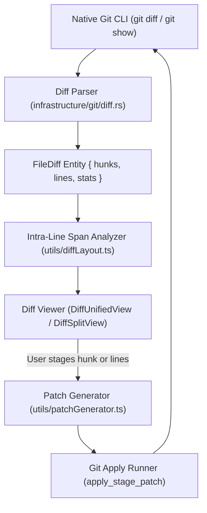

# Diff Engine & Interactive Patch Specification

> Specification for line-by-line diffing, character-level intra-line span highlights, image diff viewers, and granular hunk/selected-lines patch generation.

---

## 1. Module Overview

The GitVerse Diff Engine provides granular visual inspection and interactive patch manipulation for working tree changes, commit comparisons, and remote pull request diffs.



---

## 2. Diff Domain Models

### Rust Domain Entities (`src-tauri/src/domain/mod.rs`)

```rust
#[derive(Debug, Clone, Serialize, Deserialize, PartialEq)]
pub struct FileDiff {
    pub old_path: Option<String>,
    pub new_path: Option<String>,
    pub status: FileChangeStatus,
    pub is_binary: bool,
    pub hunks: Vec<DiffHunk>,
    pub additions_count: usize,
    pub deletions_count: usize,
}

#[derive(Debug, Clone, Serialize, Deserialize, PartialEq)]
pub struct DiffHunk {
    pub header: String,
    pub old_start: u32,
    pub old_lines: u32,
    pub new_start: u32,
    pub new_lines: u32,
    pub lines: Vec<DiffLine>,
}

#[derive(Debug, Clone, Serialize, Deserialize, PartialEq)]
pub struct DiffLine {
    pub line_type: DiffLineType, // Context, Addition, Deletion
    pub old_line_number: Option<u32>,
    pub new_line_number: Option<u32>,
    pub content: String,
}
```

---

## 3. Intra-Line Character Difference Calculation

When a deletion line is immediately followed by an addition line, the engine computes intra-line character spans using a Longest Common Subsequence (LCS) algorithm implemented in [`app/utils/diffLayout.ts`](file:///home/farshid/Desktop/self/gitverse/app/utils/diffLayout.ts):

```typescript
export interface DiffTextSpan {
  text: string
  isChanged: boolean
}

export function computeIntraLineDiff(
  oldText: string,
  newText: string,
): { oldSpans: DiffTextSpan[]; newSpans: DiffTextSpan[] }
```

### Visual Token Styling

| Element | Background Token | Border Token | Text Token |
|---|---|---|---|
| Addition Line | `--gv-diff-add-bg` (`#10b98118`) | `--gv-diff-add-border` | `--gv-diff-add-text` |
| Deletion Line | `--gv-diff-remove-bg` (`#ef444418`) | `--gv-diff-remove-border` | `--gv-diff-remove-text` |
| Modified Line / Line Range | `--gv-diff-modify-bg` (`#0284c720`) | `--gv-diff-modify-border` | `--gv-diff-modify-text` |
| Intra-line Word Addition | `--gv-diff-add-word-bg` (`#10b98140`) | — | — |
| Intra-line Word Deletion | `--gv-diff-remove-word-bg` (`#ef444440`) | — | — |
| Hunk Header (`@@ ... @@`) | `--gv-diff-hunk-bg` | — | `--gv-diff-hunk-text` |

---

## 4. Interactive Patch Generation (Hunks & Selected Lines)

GitVerse allows staging, unstaging, and discarding specific hunks or arbitrarily selected lines without touching the rest of the file.

### Patch Construction Rules (`app/utils/patchGenerator.ts`)

1. **Hunk Patch (`buildHunkPatch`)**:
   - Isolates a single `DiffHunk` and constructs a syntactically valid unified diff patch format:
     ```diff
     --- a/path/to/file.ts
     +++ b/path/to/file.ts
     @@ -10,4 +10,5 @@
      context line
     -old line
     +new line
      context line
     ```
2. **Selected Lines Patch (`buildSelectedLinesPatch`)**:
   - Recalculates hunk header counts:
     $$\text{old\_lines} = \text{context\_count} + \text{staged\_deletions\_count}$$
     $$\text{new\_lines} = \text{context\_count} + \text{staged\_additions\_count}$$
   - Non-selected additions are omitted; non-selected deletions are converted to unchanged context lines.

### Git Application Command Pipeline

- **Stage Patch**:
  `git apply --cached --unidiff-zero -`
- **Unstage Patch**:
  `git apply --cached --reverse --unidiff-zero -`
- **Discard Patch**:
  `git apply --reverse --unidiff-zero -`

---

## 5. Media & Image Diff Capabilities

For image formats (`.png`, `.jpg`, `.jpeg`, `.gif`, `.svg`, `.webp`, `.ico`), `DiffMediaViewer.vue` provides three specialized visual inspection modes:

1. **Side-by-Side (2-Up)**: Direct adjacent comparison of before and after images with image dimensions and byte sizes.
2. **Interactive Swipe (Slider)**: Horizontal split divider controlled by mouse drag or slider to reveal modifications seamlessly.
3. **Onion Skin (Crossfade)**: Adjustable opacity slider blending the old image over the new image to detect subtle pixel shifts.
