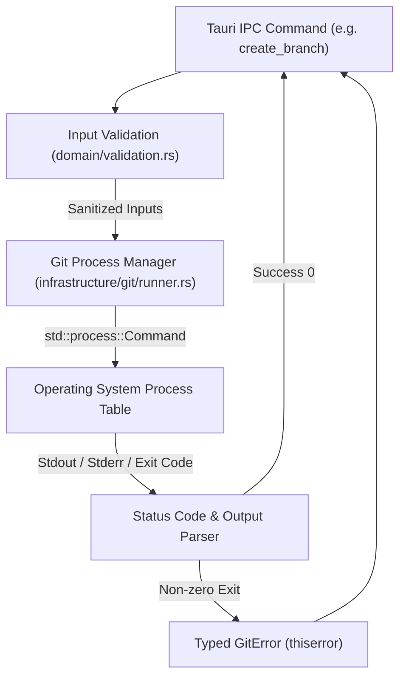

# Git CLI Process Orchestration & Safety Specification

> Specifications for secure Git CLI process spawning, argument sanitization, typed error mapping, and asynchronous execution across platforms.

---

## 1. Module Overview

Operating under **ADR-001: Native Git CLI Over libgit2**, GitVerse executes native `git` binary commands. Native Git execution provides 100% feature coverage, native SSH/GPG signing, custom credential helpers, and submodules without the memory or API lags common to C/Rust wrapper libraries.



---

## 2. Command Sanitization & Argument Vector Standard

Under **AGENTS.md Section 2.5**:
> **Never invoke shell strings via interpolation**. All Git operations must execute via argument arrays with sanitized working directory and cancellation token support.

### Prohibited Execution Patterns
```rust
// FORBIDDEN: Highly vulnerable to argument & shell injection
let cmd = format!("git checkout {}", branch_name);
std::process::Command::new("sh").arg("-c").arg(cmd).output();
```

### Mandated Execution Pattern
```rust
// MANDATED: Isolated argument vectors with explicit working directory
let mut arguments = vec!["commit", "-m", message];
if is_amend {
    arguments.push("--amend");
}
if bypass_hooks {
    arguments.push("--no-verify");
}
let output = std::process::Command::new("git")
    .current_dir(&repository_path)
    .args(&arguments)
    .output()
    .map_err(|e| GitError::Io(e.to_string()))?;
```

### Git Hook Bypass Policy (`--no-verify`)
GitVerse supports user-toggled hook bypass via the `bypass_hooks` parameter (`--no-verify` flag). When enabled, pre-commit and commit-msg hooks are skipped, allowing developers to save work-in-progress states or unblock commits when local external hook runners fail.

---

## 3. Input Validation Matrix (`src-tauri/src/domain/validation.rs`)

Before any Git process is spawned, all inputs pass through strict domain validation routines:

| Input Field | Validation Rules | Error Code / Key |
|---|---|---|
| **Branch Name** | Non-empty, no control characters, no `..`, cannot start with `-` or `/`, cannot end with `.lock` or `/`, no whitespace, no `~`, `^`, `:`, `?`, `*`, `[`, `\`. | `validation.branchName.invalid` |
| **Remote Name** | Non-empty, alphanumeric plus `.` `_` `-`, cannot start with `-`, max 255 chars. | `validation.remoteName.invalid` |
| **Remote URL** | Valid HTTPS (`https://...`), SSH (`git@...` or `ssh://...`), or local filesystem path. | `validation.remoteUrl.invalid` |
| **Commit Message** | Non-empty after trimming whitespace. | `validation.commitMessage.empty` |
| **Tag Name** | Follows Git reference refname rules, no whitespace or wildcards. | `validation.tagName.invalid` |

---

## 4. Typed Error Mapping (`thiserror`)

Errors from stderr and unexpected exit codes are parsed and mapped to strongly-typed domain errors:

```rust
#[derive(thiserror::Error, Debug, Serialize, Deserialize)]
#[serde(tag = "type", content = "message")]
pub enum GitError {
    #[error("Repository not found at path: {0}")]
    RepositoryNotFound(String),

    #[error("Working tree has merge conflicts")]
    MergeConflict(Vec<String>),

    #[error("Branch '{0}' already exists")]
    BranchAlreadyExists(String),

    #[error("Authentication failed: {0}")]
    AuthenticationFailed(String),

    #[error("Network error during remote operation: {0}")]
    NetworkError(String),

    #[error("Invalid reference name: {0}")]
    InvalidReferenceName(String),

    #[error("Command execution failed: {0}")]
    ExecutionFailed(String),
}
```

### Error Parser Patterns

```rust
pub fn parse_git_error(stderr: &str) -> GitError {
    let lower = stderr.to_lowercase();
    if lower.contains("already exists") {
        GitError::BranchAlreadyExists(extract_branch_name(stderr))
    } else if lower.contains("conflict") || lower.contains("unmerged files") {
        GitError::MergeConflict(extract_conflicted_files(stderr))
    } else if lower.contains("permission denied") || lower.contains("could not read username") {
        GitError::AuthenticationFailed(stderr.to_string())
    } else if lower.contains("could not resolve host") || lower.contains("connection refused") {
        GitError::NetworkError(stderr.to_string())
    } else {
        GitError::ExecutionFailed(stderr.to_string())
    }
}
```
