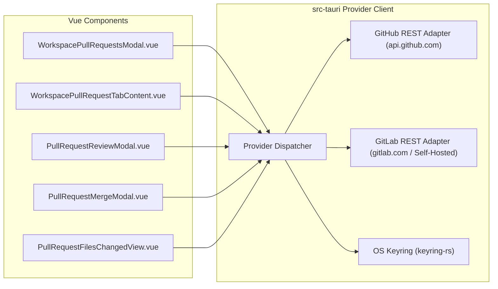
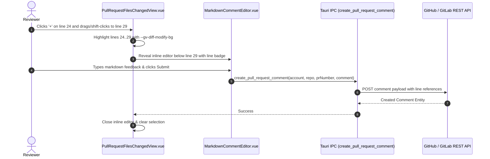

# Cloud Provider Integration Specification

> Specification for GitHub and GitLab REST integrations, OAuth/PAT credential management, pull request review workflows, and CI/CD check pipeline synchronization.

---

## 1. Module Overview

Operating under **ADR-004: Provider Abstraction Over Artificial Normalization**, GitVerse integrates directly with GitHub and GitLab. It allows developers to browse, review, comment, and merge Pull Requests/Merge Requests without opening a web browser.



---

## 2. Supported Provider Capabilities

| Feature | GitHub API | GitLab API | Supported in GitVerse |
|---|---|---|---|
| **Pull / Merge Request Listing** | `/repos/{owner}/{repo}/pulls` | `/projects/{id}/merge_requests` | Yes (Filter by Open/Merged/Closed/All) |
| **Comments & Discussion Timeline** | `/repos/{owner}/{repo}/issues/{n}/comments` | `/projects/{id}/merge_requests/{n}/notes` | Yes (Markdown rendered + Syntax highlighting) |
| **Files Changed & Patches** | `/repos/{owner}/{repo}/pulls/{n}/files` | `/projects/{id}/merge_requests/{n}/diffs` | Yes (Unified & Split View + Tree Layout) |
| **Multi-line Review Comments** | Issue comments with line range references | Discussion notes with line references | Yes (Direct inline code selection) |
| **Submitting Reviews** | `/repos/{owner}/{repo}/pulls/{n}/reviews` | Direct comment / State transition | Yes (`APPROVE`, `REQUEST_CHANGES`, `COMMENT`) |
| **Merge Pull Request** | `PUT /repos/{owner}/{repo}/pulls/{n}/merge` | `PUT /projects/{id}/merge_requests/{n}/merge` | Yes (`merge`, `squash`, `rebase`) |
| **CI / CD Check Pipeline Status** | `/repos/{owner}/{repo}/commits/{sha}/check-runs` | `/projects/{id}/pipelines` | Yes (Check status, duration, logs link) |
| **Local Branch Checkout** | Direct local Git CLI checkout tracking remote branch | Direct local Git CLI checkout tracking remote branch | Yes (One-click "Checkout" button) |

---

## 3. Remote Pull Request Domain Model (`src-tauri/src/domain/provider.rs`)

```rust
#[derive(Debug, Clone, Serialize, Deserialize, PartialEq)]
pub struct RemotePullRequest {
    pub id: String,
    pub number: u64,
    pub title: String,
    pub description: Option<String>,
    pub state: PullRequestState,
    pub author_username: String,
    pub author_avatar_url: Option<String>,
    pub source_branch: String,
    pub target_branch: String,
    pub created_at_timestamp: i64,
    pub updated_at_timestamp: i64,
    pub closed_at_timestamp: Option<i64>,
    pub merged_at: Option<String>,
    pub html_url: String,
    pub additions_count: usize,
    pub deletions_count: usize,
    pub changed_files_count: usize,
    pub pipeline_status: Option<PipelineSummary>,
}
```

---

## 4. Multi-Line Code Review Mechanism



---

## 5. Security & Authentication Architecture

1. **Token Secrecy**:
   - Personal Access Tokens (PAT) and OAuth tokens are stored exclusively in the operating system's native secure keychain (`keyring` crate: libsecret on Linux, Keychain on macOS, Credential Manager on Windows).
2. **Encrypted Fallback**:
   - If the desktop environment lacks a running secret service daemon (e.g. headless CI or minimal Linux window managers), tokens are encrypted on disk with file mode `0600`.
3. **Instance URL Flexibility**:
   - Full support for both public cloud (`github.com`, `gitlab.com`) and custom self-hosted Enterprise instances (`https://git.company.internal/api/v4`).
