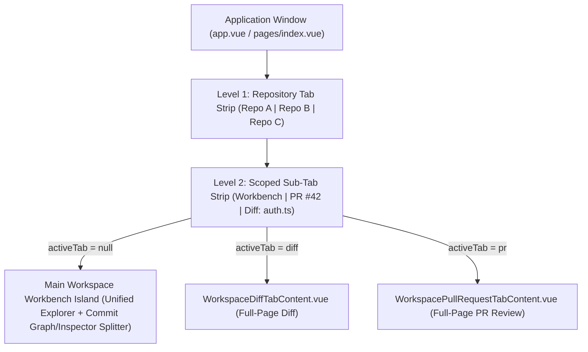

# Workspace Tab Strip & Scoped Navigation Specification

> Architecture of the 2-level tab system: multi-repository workspace tabs, scoped file diff tabs, and full-screen dedicated pull request tabs.

---

## 1. Module Overview

GitVerse uses a hierarchical, two-level tab model designed to maximize screen real estate and prevent context switching:

1. **Level 1: Repository Tab Strip (`WorkspaceRepositoryTabBar.vue`)**:
   - Represents open local repositories or independent worktree directories.
   - Persisted across application restarts via local storage.
2. **Level 2: Scoped Content Sub-Tabs (`WorkspaceDiffTabBar.vue`)**:
   - Scoped strictly to the currently active repository, docked directly above the center workspace viewport.
   - Pinned Permanent Root Tab: The first tab is always the **Overview / Commit Graph Dashboard** (`/`), permanently pinned and non-closable.
   - Dynamic Sub-Tabs: Unpinned preview tabs (italic text, replaced on single-click) and pinned persistent tabs (double-click to pin), alongside **Full-Screen Pull Request Tabs**.



---

## 2. State Controller Specification (`useWorkspaceTabController.ts`)

```typescript
export interface WorkspaceRepositoryTab {
  id: string
  repositoryPath: string
  repositoryName: string
  isClosable: boolean
}

export interface WorkspaceDiffTab {
  id: string
  title: string
  filePath: string
  repositoryPath: string
  isStaged?: boolean
  commitHash?: string
  comparisonBaseHash?: string
  comparisonTargetHash?: string
  changeStatus?: FileChangeStatus
  isClosable: boolean
  isPinned: boolean
}

export interface WorkspacePullRequestTab {
  id: string
  title: string
  pullRequest: RemotePullRequest
  account: ProviderAccount
  repositoryFullName: string
  repositoryPath: string
  isClosable: boolean
  isPinned: boolean
}
```

---

## 3. Keyboard Shortcuts & Gestures

| Action | Mouse Gesture | Keyboard Shortcut |
|---|---|---|
| **Close Tab** | Click 'x' button or middle-click tab | `Ctrl + W` / `Cmd + W` |
| **Pin / Unpin Tab** | Double click tab | `Ctrl + P` / `Cmd + P` |
| **Close Other Tabs** | Context menu -> "Close Others" | — |
| **Close All Diffs** | Click top right 'x' in sub-tab strip | — |
| **Switch Tabs** | Click tab header | `Ctrl + Tab` / `Ctrl + Shift + Tab` |
| **Open PR in Dedicated Tab** | Click "Open in Tab" (`i-lucide-maximize-2`) | — |

---

## 4. Preservation & Performance Guarantees

- **Instant Switching (`v-show`)**:
  - The main workbench island (comprising the Commit Graph SVG Canvas, Branch Sidebar, and Staging Panel) is preserved in the DOM using `v-show="!activeDiffTab && !activePullRequestTab"`.
  - Switching back and forth between a full-screen PR review and the main commit graph happens in `0ms` with zero reload latency, zero recalculation of graph layout, and zero Cumulative Layout Shift (CLS).
- **Persistence Guarantee**:
  - Open repository paths and last active repository selections persist into `localStorage` (`gitverse_open_repository_tabs` and `gitverse_last_opened_repository_path`). On launch, GitVerse rehydrates all tabs automatically.
